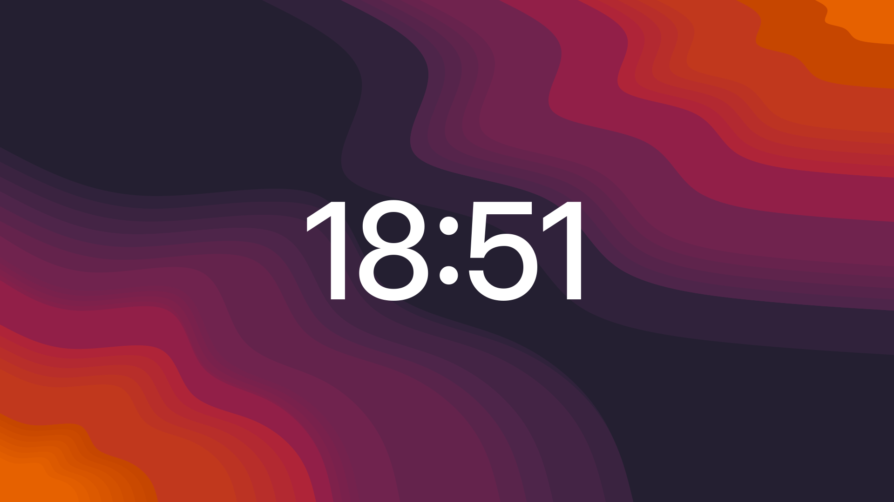
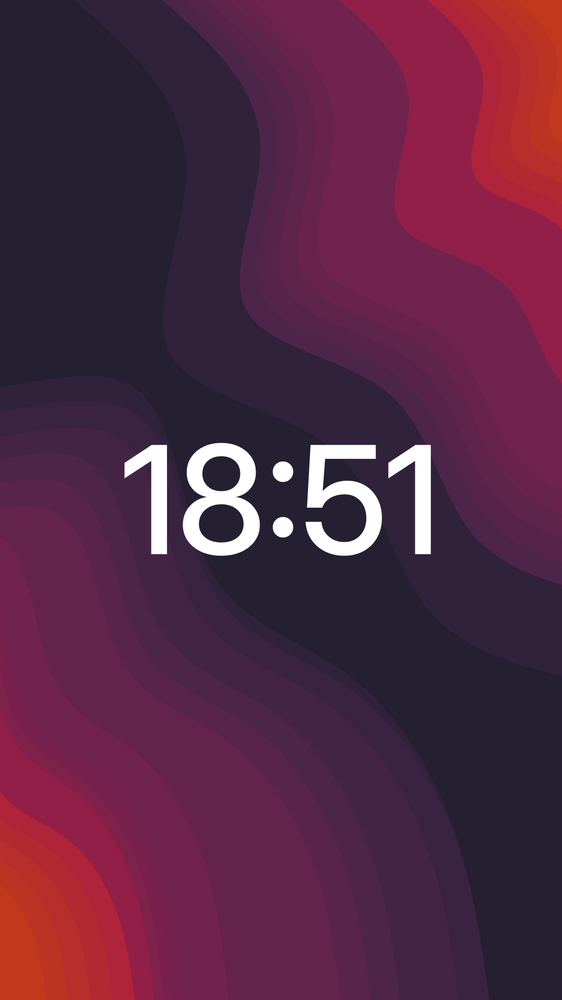

# Huge Clock

A minimal digital clock that lives on your desktop wallpaper: huge thin digits, dead center, on every monitor. No widgets, no windows, no panels — the time is painted on the wallpaper layer, behind your open windows.





## Features

- One clock per monitor, centered and scaled to the screen
- Rotated (portrait) monitors work out of the box
- Painted on the background layer: never shows up in Alt+Tab, never steals clicks
- Follows the system light/dark preference
- Optional monitor allow-list by panel vendor (EDID)
- Optional auto-hide on the primary monitor while it has windows
- No dependencies, no network access, no background daemons

## Requirements

GNOME Shell 51, on Wayland or X11.

## Installation

### extensions.gnome.org

The extension is being prepared for [extensions.gnome.org](https://extensions.gnome.org/). The link will be added here once it passes review.

### From a release

```bash
curl -LO https://github.com/nightrunner91/huge-clock/releases/latest/download/huge-clock@nightrunner91.github.io.zip
gnome-extensions install --force huge-clock@nightrunner91.github.io.zip
```

GNOME cannot hot-load a new extension on Wayland, so log out and back in, then enable it:

```bash
gnome-extensions enable huge-clock@nightrunner91.github.io
```

### From source

```bash
git clone https://github.com/nightrunner91/huge-clock.git
cd huge-clock
make install
```

Then log out, log back in and enable the extension as above.

## Configuration

There is no settings dialog yet. Every option is a constant at the top of [`impl.js`](impl.js). Edit the file and save — the running extension picks up the change within a second, no logout needed.

| Constant | Default | Description |
| --- | --- | --- |
| `FONT_FAMILY` | `"Adwaita Sans", "Cantarell"` | Font family list |
| `FONT_WEIGHT` | `500` | `400` regular, `500` medium, `700` bold |
| `SIZE_RATIO` | `0.15` | Font size as a fraction of the monitor's long side (288 px on 1920) |
| `COLOR_ON_DARK` | `rgba(255, 255, 255, 0.95)` | Colour in dark mode |
| `COLOR_ON_LIGHT` | `rgba(18, 18, 22, 0.88)` | Colour in light mode |
| `SHOW_SECONDS` | `false` | `18:51` vs `18:51:07` |
| `ONLY_VENDORS` | `['SAM']` | EDID vendor codes to show clocks on; `[]` = all monitors |
| `HIDE_ON_PRIMARY_WITH_WINDOWS` | `true` | Hide the clock on the primary monitor while it has windows |

## How it works

- The clock is an `St.Label` added to `Main.layoutManager`'s background group, so it sits between the wallpaper and the windows.
- Monitor geometry comes from Mutter. A 90°-rotated display is reported as e.g. `1080×1920`, and the font size is based on the long side (`1920`), so the clock looks the same in landscape and portrait.
- Vendor filtering reads the EDID vendor code through Mutter's `DisplayConfig` D-Bus API. The call is asynchronous on purpose: the service is hosted by the shell itself, and a blocking call would deadlock.
- Visibility is recalculated once a second. A monitor counts as busy when the active workspace has a non-minimized, non-skip-taskbar window on it.

## Development

`extension.js` is a small stable loader; `impl.js` contains the widget. The loader re-imports `impl.js` whenever its modification time changes, which is why saving the file applies changes live. A side effect: even if you break `impl.js`, fixing and saving it brings the clock back without logging out.

Build the package that is uploaded to extensions.gnome.org:

```bash
make zip
```

## License

[MIT](LICENSE)
