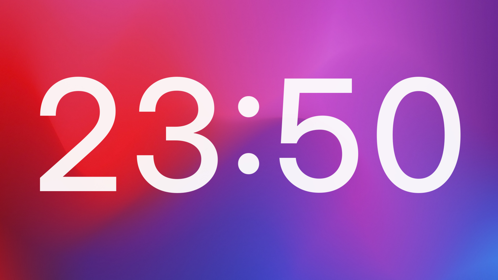

# <p align="center">Huge Clock</p>

<p align="center">
  <strong>A minimal digital clock painted on the GNOME desktop wallpaper.</strong>
</p>

<p align="center">
  
</p>

<p align="center">
  <strong> English</strong> | <a href="README.ru.md"> Russian</a>
</p>

<p align="center">
  
  
  
</p>

## Table of Contents

- [Project Overview](#project-overview)
- [Features](#features)
- [Tech Stack](#tech-stack)
- [Project Structure](#project-structure)
- [Getting Started](#getting-started)
  - [Prerequisites](#prerequisites)
  - [Installation](#installation)
  - [Quick Start](#quick-start)
- [Usage](#usage)
- [Configuration](#configuration)
- [How It Works](#how-it-works)
- [Development](#development)
- [Contributing](#contributing)
- [License](#license)

## Project Overview

**Huge Clock** is a GNOME Shell extension that draws a huge thin digital clock in the middle of every monitor, directly on the wallpaper layer. It looks like part of your desktop background rather than a widget: it never appears in Alt+Tab, never sits in a panel, and never steals clicks.

The extension is intentionally small. It has no dependencies, no network access, no background daemons, and no separate window. Everything is a few hundred lines of GJS, and every option is exposed through the standard GNOME preferences dialog.

## Features

- **One clock per monitor** — centered and scaled to each screen independently.
- **Portrait-friendly** — rotated displays work out of the box.
- **Wallpaper layer** — painted behind your windows, invisible to Alt+Tab and pointer input.
- **Live preferences** — a native GTK4/libadwaita settings window; changes apply immediately.
- **Font customization** — family, weight, and size as a percentage of the monitor.
- **Light and dark colours** — separate colours chosen automatically from the system preference.
- **Optional seconds** — `18:51` or `18:51:07`.
- **Monitor allow-list** — restrict the clock to specific EDID panel vendors.
- **Auto-hide on the primary monitor** — while it has windows.
- **No dependencies, no network access, no background daemons**.

## Tech Stack

| Component | Technology | Description |
| :--- | :--- | :--- |
| **Shell** | [GNOME Shell 51](https://www.gnome.org/) | Extension runtime, on Wayland or X11 |
| **Language** | GJS | JavaScript bindings for GObject Introspection |
| **Widget** | St / Clutter | Shell actors drawn on the background layer |
| **Settings** | GSettings | Schema-backed storage, readable via `gsettings` |
| **Preferences** | GTK 4 + libadwaita | Native GNOME preferences window |
| **Packaging** | Make + zip | Builds the archive uploaded to extensions.gnome.org |

## Project Structure

```text
huge-clock/
├── extension.js                       # Stable loader with live reload of impl.js
├── impl.js                            # The clock widget itself
├── prefs.js                           # Preferences window (GTK4 / libadwaita)
├── metadata.json                      # Extension manifest
├── schemas/
│   └── org.gnome.shell.extensions.huge-clock.gschema.xml
├── screenshots/
│   └── landscape.jpg
├── Makefile                           # zip / install helpers
├── README.md
├── README.ru.md
└── LICENSE
```

`schemas/gschemas.compiled` is generated by the Makefile and is not tracked by Git.

## Getting Started

### Prerequisites

- GNOME Shell 51, on Wayland or X11.
- For release installs: the `gnome-extensions` command-line tool.
- For source installs: `make`, `zip`, and `glib-compile-schemas` (part of GLib; usually already present on a GNOME desktop).

### Installation

The extension is being prepared for [extensions.gnome.org](https://extensions.gnome.org/). The link will be added here once it passes review.

From a release:

```bash
curl -LO https://github.com/nightrunner91/huge-clock/releases/latest/download/huge-clock@nightrunner91.github.io.zip
gnome-extensions install --force huge-clock@nightrunner91.github.io.zip
```

GNOME cannot hot-load a new extension on Wayland, so log out and back in.

From source:

```bash
git clone https://github.com/nightrunner91/huge-clock.git
cd huge-clock
make install
```

`make install` compiles the GSettings schema into the extension directory. Log out and back in afterwards.

### Quick Start

```bash
gnome-extensions enable huge-clock@nightrunner91.github.io
gnome-extensions prefs huge-clock@nightrunner91.github.io
```

The preferences window can also be opened from the Extensions app.

## Usage

On a landscape 1920×1080 monitor the font size is 288 px; on a portrait 1080×1920 monitor it is the same, because the font is scaled from the monitor's long side. A clock is created for every monitor that passes the vendor allow-list.

The colour follows the system light/dark preference. When the primary monitor has non-minimized windows, the clock there can hide itself so it never sits behind your work; other monitors are not affected.

## Configuration

All options live in the standard preferences window (`gnome-extensions prefs huge-clock@nightrunner91.github.io`) and are stored in GSettings under `org.gnome.shell.extensions.huge-clock`.

| Key | Default | Description |
| --- | --- | --- |
| `font-family` | `Adwaita Sans, Cantarell` | Comma-separated CSS font family list |
| `font-weight` | `500` | `400` regular, `500` medium, `700` bold |
| `size-percent` | `15.0` | Font size as a percentage of the monitor's long side |
| `color-on-dark` | `rgba(255, 255, 255, 0.95)` | Colour in dark mode |
| `color-on-light` | `rgba(18, 18, 22, 0.88)` | Colour in light mode |
| `show-seconds` | `false` | `18:51` vs `18:51:07` |
| `only-vendors` | `[]` | EDID vendor codes to show clocks on; empty means all monitors |
| `hide-on-primary-with-windows` | `true` | Hide the primary monitor clock while it has windows |

Every change applies immediately — no logout or extension reload is needed. The same keys can be changed from the command line:

```bash
gsettings --schemadir ~/.local/share/gnome-shell/extensions/huge-clock@nightrunner91.github.io/schemas \
  set org.gnome.shell.extensions.huge-clock show-seconds true
```

> [!TIP]
> Vendor codes are the first three letters of the EDID manufacturer ID. Common examples: `SAM` for Samsung, `BNQ` for BenQ, `DEL` for Dell, `GSM` for LG.

## How It Works

- The clock is an `St.Label` added to `Main.layoutManager`'s background group, so it sits between the wallpaper and the windows.
- Monitor geometry comes from Mutter. A 90°-rotated display is reported as e.g. `1080×1920`, and the font size is based on the long side, so the clock looks the same in landscape and portrait.
- Vendor filtering reads the EDID vendor code through Mutter's `DisplayConfig` D-Bus API. The call is asynchronous on purpose: the service is hosted by the shell itself, and a blocking call would deadlock.
- Visibility is recalculated once a second. A monitor counts as busy when the active workspace has a non-minimized, non-skip-taskbar window on it.
- Preferences are GSettings keys. The widget subscribes to `changed::` signals and updates text, style, visibility, or the monitor list without rebuilding everything.

## Development

`extension.js` is a small stable loader; `impl.js` contains the widget. The loader re-imports `impl.js` whenever its modification time changes, which is why saving the file applies changes live. A side effect: even if you break `impl.js`, fixing and saving it brings the clock back without logging out.

`prefs.js` is discovered automatically by GNOME Shell. After editing the schema, recompile it:

```bash
glib-compile-schemas schemas
```

Build the package that is uploaded to extensions.gnome.org:

```bash
make zip
```

Install the working tree directly into the local extensions directory:

```bash
make install
```

## Contributing

Issues and pull requests are welcome. Please test changes on GNOME Shell 51, on both Wayland and X11 if possible, and keep the extension dependency-free. For user-visible changes, update both README files.

## License

This project is licensed under the [MIT License](LICENSE).

---

<p align="center">
  Built with ❤ by <a href="https://t.me/nightrunner91">nightrunner91</a>
</p>
