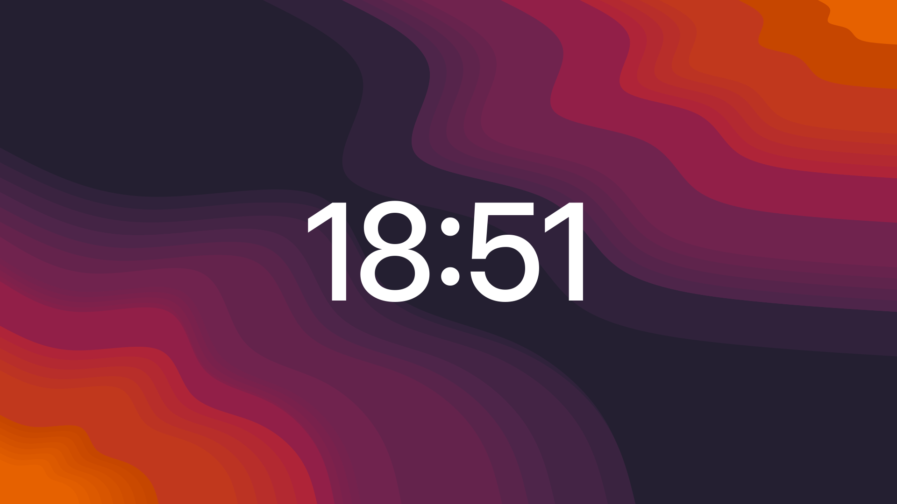

# <p align="center">Huge Clock</p>

<p align="center">
  <strong>Минимальные цифровые часы, нарисованные прямо на обоях рабочего стола GNOME.</strong>
</p>

<p align="center">
  
</p>

<p align="center">
  <a href="README.md"> English</a> | <strong> Русский</strong>
</p>

<p align="center">
  
  
  
</p>

## Содержание

- [Обзор проекта](#обзор-проекта)
- [Возможности](#возможности)
- [Технологический стек](#технологический-стек)
- [Структура проекта](#структура-проекта)
- [Начало работы](#начало-работы)
  - [Требования](#требования)
  - [Установка](#установка)
  - [Быстрый старт](#быстрый-старт)
- [Использование](#использование)
- [Конфигурация](#конфигурация)
- [Как это работает](#как-это-работает)
- [Разработка](#разработка)
- [Участие в разработке](#участие-в-разработке)
- [Лицензия](#лицензия)

## Обзор проекта

**Huge Clock** — расширение GNOME Shell, которое рисует огромные тонкие цифровые часы по центру каждого монитора прямо на слое обоев. Они выглядят как часть фона рабочего стола, а не как виджет: часы не появляются в Alt+Tab, не занимают панель и не перехватывают клики.

Расширение намеренно небольшое. У него нет зависимостей, сетевого доступа, фоновых демонов и отдельного окна. Всё это — несколько сотен строк на GJS, а каждая настройка доступна через стандартное окно параметров GNOME.

## Возможности

- **Одни часы на монитор** — центрируются и масштабируются для каждого экрана независимо.
- **Поддержка портретной ориентации** — повёрнутые дисплеи работают из коробки.
- **Слой обоев** — часы рисуются за окнами и невидимы для Alt+Tab и указателя.
- **Живые настройки** — нативное окно параметров на GTK4/libadwaita; изменения применяются мгновенно.
- **Настройка шрифта** — семейство, насыщенность и размер в процентах от монитора.
- **Цвета для светлой и тёмной темы** — отдельные цвета, выбираемые автоматически по системной настройке.
- **Секунды по желанию** — `18:51` или `18:51:07`.
- **Список разрешённых мониторов** — ограничение по EDID-коду производителя панели.
- **Автоскрытие на основном мониторе** — пока на нём есть окна.
- **Без зависимостей, сетевого доступа и фоновых демонов**.

## Технологический стек

| Компонент | Технология | Описание |
| :--- | :--- | :--- |
| **Оболочка** | [GNOME Shell 51](https://www.gnome.org/) | Среда выполнения расширения, Wayland или X11 |
| **Язык** | GJS | JavaScript-привязки для GObject Introspection |
| **Виджет** | St / Clutter | Акторы оболочки на слое обоев |
| **Настройки** | GSettings | Хранилище на основе схемы, доступное через `gsettings` |
| **Параметры** | GTK 4 + libadwaita | Нативное окно параметров GNOME |
| **Упаковка** | Make + zip | Сборка архива для extensions.gnome.org |

## Структура проекта

```text
huge-clock/
├── extension.js                       # Стабильный загрузчик с живой перезагрузкой impl.js
├── impl.js                            # Сам виджет часов
├── prefs.js                           # Окно параметров (GTK4 / libadwaita)
├── metadata.json                      # Манифест расширения
├── schemas/
│   └── org.gnome.shell.extensions.huge-clock.gschema.xml
├── screenshots/
│   └── landscape.png
├── Makefile                           # Помощники zip / install
├── README.md
├── README.ru.md
└── LICENSE
```

`schemas/gschemas.compiled` создаётся Makefile и не хранится в Git.

## Начало работы

### Требования

- GNOME Shell 51, Wayland или X11.
- Для установки из релиза: утилита командной строки `gnome-extensions`.
- Для установки из исходников: `make`, `zip` и `glib-compile-schemas` (входит в GLib; обычно уже есть в GNOME).

### Установка

Расширение готовится к публикации на [extensions.gnome.org](https://extensions.gnome.org/). Ссылка появится здесь после прохождения проверки.

Из релиза:

```bash
curl -LO https://github.com/nightrunner91/huge-clock/releases/latest/download/huge-clock@nightrunner91.github.io.zip
gnome-extensions install --force huge-clock@nightrunner91.github.io.zip
```

GNOME не умеет подхватывать новое расширение на лету в Wayland, поэтому выйдите из сеанса и войдите снова.

Из исходников:

```bash
git clone https://github.com/nightrunner91/huge-clock.git
cd huge-clock
make install
```

`make install` компилирует схему GSettings в каталог расширения. После этого также нужно выйти из сеанса и войти снова.

### Быстрый старт

```bash
gnome-extensions enable huge-clock@nightrunner91.github.io
gnome-extensions prefs huge-clock@nightrunner91.github.io
```

Окно параметров также можно открыть из приложения «Расширения».

## Использование

На мониторе 1920×1080 в альбомной ориентации размер шрифта составляет 288 px; на мониторе 1080×1920 в портретной ориентации он тот же, потому что шрифт масштабируется от длинной стороны монитора. Часы создаются для каждого монитора, прошедшего список разрешённых производителей.

Цвет следует системной светлой или тёмной теме. Если на основном мониторе есть неразвёрнутые окна, часы там могут скрываться, чтобы не оказаться за рабочей областью; на остальные мониторы это не влияет.

## Конфигурация

Все параметры находятся в стандартном окне параметров (`gnome-extensions prefs huge-clock@nightrunner91.github.io`) и хранятся в GSettings под `org.gnome.shell.extensions.huge-clock`.

| Ключ | По умолчанию | Описание |
| --- | --- | --- |
| `font-family` | `Adwaita Sans, Cantarell` | Список семейств шрифтов CSS через запятую |
| `font-weight` | `500` | `400` обычный, `500` средний, `700` жирный |
| `size-percent` | `15.0` | Размер шрифта в процентах от длинной стороны монитора |
| `color-on-dark` | `rgba(255, 255, 255, 0.95)` | Цвет в тёмной теме |
| `color-on-light` | `rgba(18, 18, 22, 0.88)` | Цвет в светлой теме |
| `show-seconds` | `false` | `18:51` или `18:51:07` |
| `only-vendors` | `[]` | EDID-коды производителей; пустой список — все мониторы |
| `hide-on-primary-with-windows` | `true` | Скрывать часы на основном мониторе, пока на нём есть окна |

Любое изменение применяется сразу — перезагрузка или перезапуск расширения не нужны. Те же ключи можно изменить из командной строки:

```bash
gsettings --schemadir ~/.local/share/gnome-shell/extensions/huge-clock@nightrunner91.github.io/schemas \
  set org.gnome.shell.extensions.huge-clock show-seconds true
```

> [!TIP]
> Код производителя — это первые три буквы EDID manufacturer ID. Частые примеры: `SAM` для Samsung, `BNQ` для BenQ, `DEL` для Dell, `GSM` для LG.

## Как это работает

- Часы — это `St.Label`, добавленный в группу фона `Main.layoutManager`, поэтому они находятся между обоями и окнами.
- Геометрия мониторов берётся из Mutter. Дисплей, повёрнутый на 90°, сообщается как `1080×1920`, а размер шрифта считается от длинной стороны, поэтому часы выглядят одинаково в альбомной и портретной ориентации.
- Фильтр производителей читает EDID-код через D-Bus API Mutter `DisplayConfig`. Вызов намеренно асинхронный: сервис обслуживается самой оболочкой, и блокирующий вызов привёл бы к взаимной блокировке.
- Видимость пересчитывается раз в секунду. Монитор считается занятым, если на активном рабочем пространстве есть неразвёрнутое окно без флага skip-taskbar.
- Параметры — это ключи GSettings. Виджет подписывается на сигналы `changed::` и обновляет текст, стиль, видимость или список мониторов без полной перестройки.

## Разработка

`extension.js` — небольшой стабильный загрузчик; `impl.js` содержит виджет. Загрузчик переимпортирует `impl.js` при каждом изменении времени модификации, поэтому сохранение файла применяет изменения на лету. Побочный эффект: даже если сломать `impl.js`, его исправление и сохранение вернут часы без выхода из сеанса.

`prefs.js` обнаруживается GNOME Shell автоматически. После изменения схемы её нужно перекомпилировать:

```bash
glib-compile-schemas schemas
```

Собрать пакет для extensions.gnome.org:

```bash
make zip
```

Установить рабочее дерево напрямую в локальный каталог расширений:

```bash
make install
```

## Участие в разработке

Issues и pull requests приветствуются. Проверяйте изменения на GNOME Shell 51, по возможности и в Wayland, и в X11, и не добавляйте зависимостей. При изменениях, заметных пользователю, обновляйте оба README.

## Лицензия

Этот проект распространяется под лицензией [MIT](LICENSE).

---

<p align="center">
  Сделано с ❤ <a href="https://t.me/nightrunner91">nightrunner91</a>
</p>
